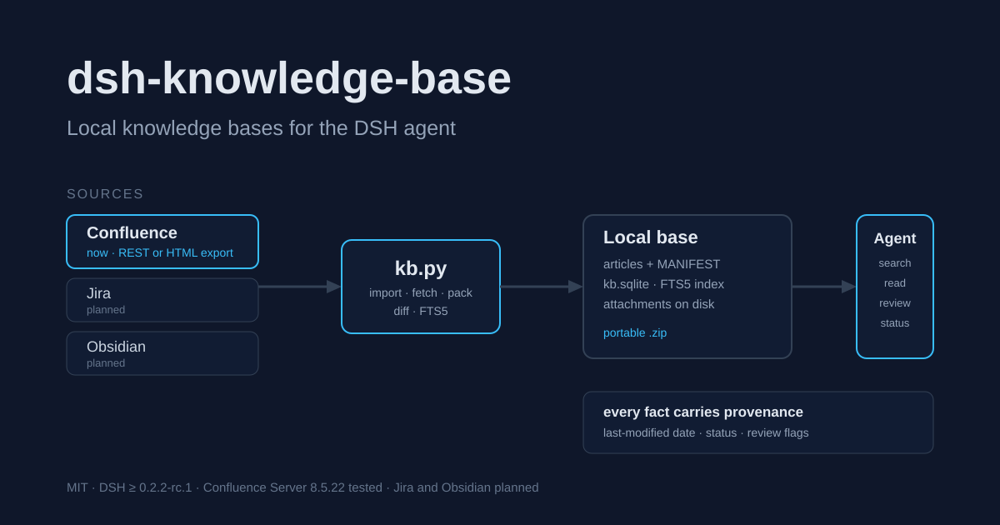

# dsh-knowledge-base

Local knowledge bases for the DSH agent, built from external sources. **Confluence Server / Data
Center** is supported today — over its REST API or from an HTML export zip; **Jira, Obsidian and
other sources are planned**.


Russian version: [README.ru.md](README.ru.md).



## What it does

- **Sources and bases.** Several sources can be configured; each owns its own directory, search
  index, schedule and import job, so one wiki never writes into another's base.
- **Default source and workspace sets.** One source is the default; a workspace may bind an
  ordered set of sources instead.
- **Two ways in.** A Confluence Server / Data Center URL with a personal access token or a user
  and password, or an HTML export zip on disk. A server that ignores the token is reported as
  answering anonymously instead of showing an empty space list.
- **Agent tools with provenance.** `kb_search`, `kb_read`, `kb_review` and `kb_status` return the
  article's last-modified date, status and review flags with every result, so an old fact is
  flagged instead of trusted.
- **Scheduled imports.** Incremental and full passes; the Host imports on its own timer while the
  DSH app is running.
- **Live progress and Stop.** The engine prints page progress; the page shows pages done, the
  current space, elapsed time and a bar, and Stop ends the run as `cancelled`.
- **Portable bases.** Export a base to a `.zip` with a chosen folder and name, then import it on
  another machine without Confluence and keep updating it from the same server with new
  credentials. The archive carries the base URL and never credentials.
- **A frozen base URL.** Once a source has imported, its URL is read-only; deleting the base files
  unlocks it, deleting the source removes them too.
- **An honest run report.** Each run writes a report into the Automation tasks page — a report,
  not a reminder.
- **Bilingual.** The settings page, reports and tool-card titles follow Russian or English.

## Requirements

- DSH Desktop `0.2.2-rc.x` (tested with `0.2.2-rc.5`).
- Python 3 for the engine; the plugin uses the runtime bundled with DSH when present.
- Node 22.5+ with `node:sqlite` and FTS5 — the desktop app provides it.
- Confluence Server `8.5.22` was tested; Data Center is expected to work but was not verified on a
  live instance; Confluence Cloud is not supported. Details: [docs/COMPATIBILITY.md](docs/COMPATIBILITY.md).

## Install from a release

1. Download `dsh-knowledge-base-<version>.tgz` and `skill.zip` from the GitHub Releases page.
2. Unpack `skill.zip` into `%USERPROFILE%\.dsh\skills\knowledge-base\` — the plugin runs `kb.py`
   from there on every import.
3. Install the bundle: DSH → Plugins → Add plugin → choose the `.tgz` (or
   `plugin_manager install_bundle <path>`).
4. Restart the app: the plugin starts with the Host and waits for its HTTP service.
5. Settings → Knowledge base → add a source (name and id), test the connection, save, import.

## Build from source

```powershell
git clone https://github.com/flumpfox/dsh-knowledge-base.git
cd dsh-knowledge-base

npm test                 # engine cases plus the plugin suite
npm run pack             # -> dist/dsh-knowledge-base-<version>.tgz
npm run check-secrets    # pre-publication scan of the tree and the package
```

For development against a live DSH profile, link `plugin/` into the profile and toggle the bundle
with `set_bundle`; the linked code reloads without a restart, client changes need a page refresh.

## Documentation

- [Plugin detail](plugin/docs/DETAIL.md) — behaviour, requirements, limitations (Russian:
  [DETAIL.ru.md](plugin/docs/DETAIL.ru.md)).
- [docs/COMPATIBILITY.md](docs/COMPATIBILITY.md) — tested versions and known exclusions.
- [docs/DEVELOPMENT.md](docs/DEVELOPMENT.md) — environment, layout, tests, debugging.
- [docs/ARCHITECTURE.md](docs/ARCHITECTURE.md) — components and data flow.
- [docs/DECISIONS.md](docs/DECISIONS.md) — why the design is what it is.
- [docs/FAQ.md](docs/FAQ.md) — the questions that come up in practice.
- [docs/UPGRADING.md](docs/UPGRADING.md) — moving an installation to 1.0.0.
- [CHANGELOG.md](CHANGELOG.md) — what changed per release.

## Scope and limitations

- One base per source; search is lexical (FTS5 prefix matching), not semantic.
- Nothing reaches Confluence live: a page changed after the last import is invisible until the
  next import, and `kb_status` reports a stale index instead of repairing it.
- Attachments are files on disk, not indexed text.
- An exported base is not encrypted: it holds article text and attachments, no credentials.
- The in-app browser is an isolated session and does not receive the plugin's credentials; use the
  default browser for the original wiki page (Settings → General → “Open chat links in”).
- Confluence Cloud is out of scope: its API and authorization differ.

## License

MIT. The software is provided “as is”, without warranty; the data comes from external systems and
the user is responsible for how it is used.

## Acknowledgements

Built together with the DeepSeek Harness agent, which wrote code, tests and documentation under
the author's review.
