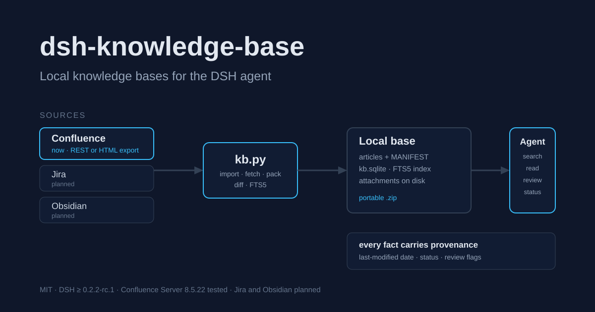

# dsh-knowledge-base

Локальные базы знаний для агента DSH, собираемые из внешних источников. Сейчас поддерживается
**Confluence Server / Data Center** — по REST API или из zip-архива HTML-экспорта; **Jira,
Obsidian и другие источники — в планах**.


English version: [README.md](README.md).



## Что умеет

- **Источники и базы.** Источников может быть несколько; у каждого свой каталог, поисковый
  индекс, расписание и задача импорта, поэтому одна вики никогда не пишет в чужую базу.
- **Источник по умолчанию и наборы рабочих областей.** Один источник помечается основным; рабочая
  область может вместо него привязать упорядоченный набор.
- **Два способа входа.** URL Confluence Server / Data Center с Personal Access Token или с логином
  и паролем, либо zip-архив HTML-экспорта на диске. Сервер, игнорирующий токен, распознаётся как
  анонимный, а не показывается пустым списком пространств.
- **Инструменты агента с провенансом.** `kb_search`, `kb_read`, `kb_review` и `kb_status`
  возвращают дату изменения статьи, статус и флаги ревизии с каждым результатом, поэтому старый
  факт помечается, а не принимается на веру.
- **Импорт по расписанию.** Инкрементальный и полный проходы; Host импортирует сам по таймеру,
  пока запущено приложение DSH.
- **Живой прогресс и остановка.** Движок печатает прогресс по страницам; страница показывает
  обработанные страницы, текущее пространство, время и полосу, а «Остановить» завершает запуск
  состоянием `cancelled`.
- **Переносимые базы.** Экспорт базы в `.zip` с выбранными папкой и именем, затем импорт на другой
  машине без Confluence и обновление с того же сервера с новыми кредами. В архив попадает базовый
  URL и никогда — учётные данные.
- **Зафиксированный базовый URL.** После первого импорта URL источника только для чтения;
  удаление файлов базы разблокирует его, удаление источника убирает и их.
- **Честный отчёт о запуске.** Каждый запуск пишет отчёт на страницу задач автоматизации — это
  отчёт, а не напоминание.
- **Два языка.** Страница настроек, отчёты и заголовки карточек инструментов следуют русскому или
  английскому.

## Требования

- DSH Desktop `0.2.2-rc.x` (проверено на `0.2.2-rc.5`).
- Python 3 для движка; плагин берёт встроенный в DSH runtime, если он есть.
- Node 22.5+ с `node:sqlite` и FTS5 — приложение предоставляет его.
- Confluence Server `8.5.22` проверен; Data Center должен работать, но на живом экземпляре не
  проверялся; Confluence Cloud не поддерживается. Подробности:
  [docs/COMPATIBILITY.ru.md](docs/COMPATIBILITY.ru.md).

## Установка из релиза

1. Скачайте `dsh-knowledge-base-<версия>.tgz` и `skill.zip` со страницы GitHub Releases.
2. Распакуйте `skill.zip` в `%USERPROFILE%\.dsh\skills\knowledge-base\` — плагин запускает `kb.py`
   оттуда при каждом импорте.
3. Установите бандл: DSH → Plugins → Add plugin → выберите `.tgz` (или
   `plugin_manager install_bundle <путь>`).
4. Перезапустите приложение: плагин поднимается вместе с Host и ждёт свой HTTP-сервис.
5. Настройки → База знаний → добавьте источник (имя и id), проверьте подключение, сохраните,
   импортируйте.

## Сборка из исходников

```powershell
git clone https://github.com/flumpfox/dsh-knowledge-base.git
cd dsh-knowledge-base

npm test                 # кейсы движка и набор тестов плагина
npm run pack             # -> dist/dsh-knowledge-base-<версия>.tgz
npm run check-secrets    # проверка дерева и пакета перед публикацией
```

Для разработки на живом профиле DSH подключите `plugin/` ссылкой и переключайте бандл через
`set_bundle`; связанный код перезагружается без перезапуска, клиентские изменения требуют
обновления страницы.

## Документация

- [Описание плагина](plugin/docs/DETAIL.ru.md) — поведение, требования, ограничения (по-английски:
  [DETAIL.md](plugin/docs/DETAIL.md)).
- [docs/COMPATIBILITY.ru.md](docs/COMPATIBILITY.ru.md) — проверенные версии и известные исключения.
- [docs/DEVELOPMENT.ru.md](docs/DEVELOPMENT.ru.md) — окружение, структура, тесты, отладка.
- [docs/ARCHITECTURE.ru.md](docs/ARCHITECTURE.ru.md) — компоненты и потоки данных.
- [docs/DECISIONS.ru.md](docs/DECISIONS.ru.md) — почему устройство именно такое.
- [docs/FAQ.ru.md](docs/FAQ.ru.md) — вопросы, которые возникают на практике.
- [docs/UPGRADING.ru.md](docs/UPGRADING.ru.md) — переход установки на 1.0.0.
- [CHANGELOG.ru.md](CHANGELOG.ru.md) — что изменилось от релиза к релизу.

## Область и ограничения

- Одна база на источник; поиск лексический (FTS5 с префиксным совпадением), не семантический.
- Онлайн-доступа к Confluence нет: страница, изменённая после последнего импорта, не видна до
  следующего импорта, а `kb_status` сообщает об отставании индекса, а не чинит его.
- Вложения — файлы на диске, а не индексированный текст.
- Экспортированная база не шифруется: в ней тексты статей и вложения, учётных данных нет.
- Встроенный браузер — изолированная сессия и не получает креды плагина; для страницы вики
  используйте браузер по умолчанию (Настройки → Общие → «Открыть ссылки на чат в»).
- Confluence Cloud вне области: у него другие API и авторизация.

## Лицензия

MIT. Программа предоставляется «как есть», без гарантий; данные приходят из внешних систем, и
ответственность за их использование несёт пользователь.

## Благодарности

Проект разработан вместе с агентом DeepSeek Harness: он писал код, тесты и документацию под
ревью автора.
