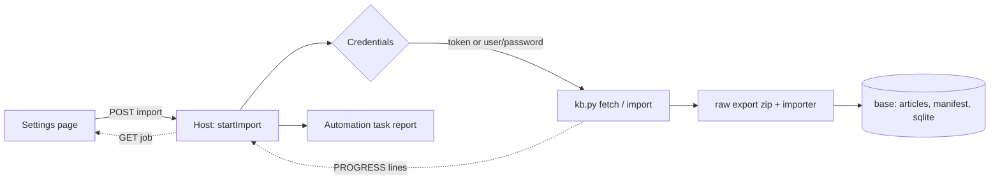
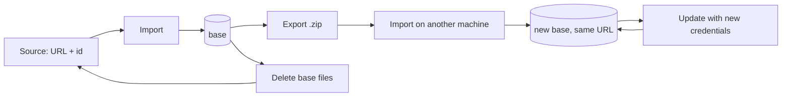

# Architecture

## Components

| Layer | Piece | Responsibility |
|---|---|---|
| Host plugin | `plugin/index.js` | registers the four tools; loads `@deepseek-ai/dsh-tools` lazily |
| Host plugin | `plugin/server.js` | routes, per-source jobs, credentials, export/import of bases |
| Host plugin | `plugin/lib/registry.js` | pure source registry: sources, default, workspace sets |
| Host plugin | `plugin/lib/core.js` | pure helpers: progress, URL, paths, dates |
| Engine | `engine/kb.py` | HTML/REST parsing, diff, index and FTS5, portable archives |
| Client | `plugin/client.js` | the Settings → Knowledge base section |
| Skill | `skill/scripts/kb.py` | the same engine, installed under `~/.dsh/skills/knowledge-base` |

The Host never parses Confluence HTML: it spawns the engine and reads its exit code, its
`PROGRESS`/`PACK` lines on stderr and the run summary on stdout.

## Import flow

## Base lifecycle

## Data on disk

| Path | Content |
|---|---|
| `~/.dsh/kb/knowledge-sources.json` | registry: sources, the default one, workspace sets |
| `~/.dsh/kb/<id>/` | one base: article files, `MANIFEST.jsonl`, `kb.sqlite`, `attachments/` |
| `~/.dsh/kb/exports/` | archives written by the export route |
| `~/.dsh/.credentials.yaml` | the DSH credential store (never in git) |
| `~/.dsh/skills/knowledge-base/` | the skill and its engine copy |

## Credentials and the base URL

- One record per source, keyed `<scope>/<id>` with scope `knowledge-base-tools`. The provider
  rejects any other shape, and a malformed key stops the app from loading its credentials file.
- The URL is frozen once a source imports: articles carry source URLs, so pointing the source
  elsewhere would make the base claim a server that never hosted it.
- A source restored from an archive keeps its URL permanently.

## Failure boundaries

- The engine is a separate process: a crash or Stop ends that run, not the Host.
- Jobs are per source; a running import refuses a second one for the same source.
- Credential values live in memory only for the run and reach the engine through the environment,
  never through argv.
