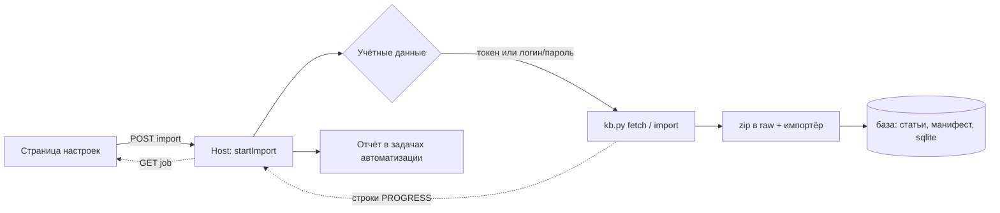
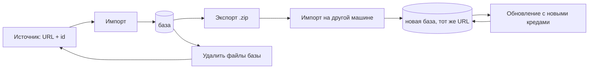

# Архитектура

## Компоненты

| Слой | Часть | Ответственность |
|---|---|---|
| Host-плагин | `plugin/index.js` | регистрирует четыре инструмента; грузит `@deepseek-ai/dsh-tools` лениво |
| Host-плагин | `plugin/server.js` | маршруты, задачи на источник, учётные данные, экспорт/импорт баз |
| Host-плагин | `plugin/lib/registry.js` | чистая модель реестра: источники, умолчание, наборы рабочих областей |
| Host-плагин | `plugin/lib/core.js` | чистые помощники: прогресс, URL, пути, даты |
| Движок | `engine/kb.py` | разбор HTML/REST, diff, индекс и FTS5, переносимые архивы |
| Клиент | `plugin/client.js` | раздел «Настройки → База знаний» |
| Скилл | `skill/scripts/kb.py` | тот же движок, установленный в `~/.dsh/skills/knowledge-base` |

Host сам не разбирает HTML Confluence: он запускает движок и читает код возврата, строки
`PROGRESS`/`PACK` в stderr и сводку запуска в stdout.

## Поток импорта

## Жизненный цикл базы

## Данные на диске

| Путь | Содержимое |
|---|---|
| `~/.dsh/kb/knowledge-sources.json` | реестр: источники, основной, наборы рабочих областей |
| `~/.dsh/kb/<id>/` | одна база: файлы статей, `MANIFEST.jsonl`, `kb.sqlite`, `attachments/` |
| `~/.dsh/kb/exports/` | архивы, созданные маршрутом экспорта |
| `~/.dsh/.credentials.yaml` | хранилище секретов DSH (в git не попадает) |
| `~/.dsh/skills/knowledge-base/` | скилл и копия движка |

## Учётные данные и базовый URL

- Одна запись на источник, ключ `<scope>/<id>` со scope `knowledge-base-tools`. Провайдер
  отвергает любую другую форму, а испорченный ключ не даёт приложению загрузить файл секретов.
- URL фиксируется после первого импорта: статьи хранят адреса первоисточника, и переназначение
  источника заставило бы базу ссылаться на сервер, который её не отдавал.
- Источник, восстановленный из архива, хранит URL навсегда.

## Границы отказов

- Движок — отдельный процесс: падение или «Остановить» завершает только этот запуск, не Host.
- Задачи — на каждый источник; идущий импорт не даёт запустить второй для того же источника.
- Значения кредов живут в памяти только на время запуска и попадают в движок через окружение,
  никогда через argv.
